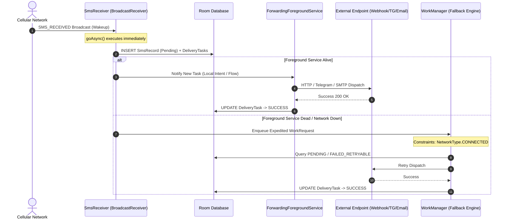
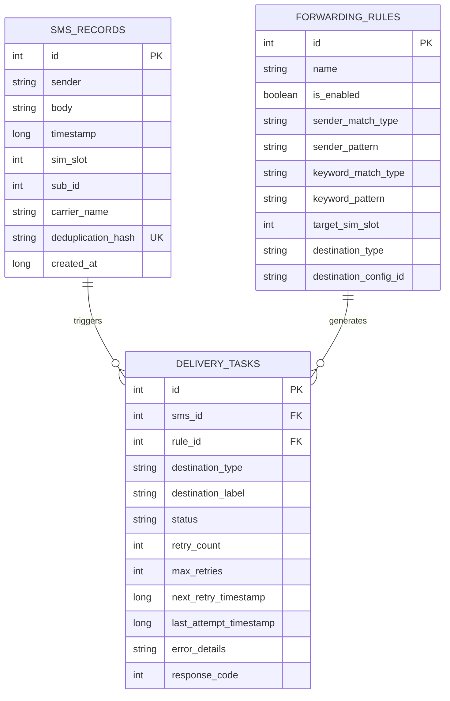

# Phase 1: Technical Feasibility & Android OS Constraints Research

**Project:** Personal Android SMS Forwarder  
**Document ID:** DOC-PH1-TECH-FEASIBILITY  
**Status:** Approved / Ready for Architecture & Implementation  
**Target Environment:** Android 8.0 (API 26) through Android 15 (API 35)  
**Distribution:** Personal Sideloaded APK  

---

## 1. Executive Summary

This research report establishes the technical feasibility, system constraints, API specifications, and architectural patterns for developing an independent, personal Android SMS Forwarder. The application operates entirely locally on device without external backend infrastructure, intercepting incoming SMS messages and reliably forwarding them to Webhook (HTTP/HTTPS), Telegram Bot API, and SMTP Email destinations.

### Key Technical Verdicts:
1. **SMS Interception:** Feasible via manifest-declared `BroadcastReceiver` listening to `android.provider.Telephony.SMS_RECEIVED`. Despite Android 8.0+ implicit broadcast restrictions, `SMS_RECEIVED` is an explicit OS exception that functions reliably even when the app is in the background or process is killed.
2. **Background Execution & Zero-Miss Delivery:** A **hybrid architecture** combining a persistent Foreground Service (`specialUse` / `dataSync` type with ongoing notification) and WorkManager expedited jobs guarantees zero dropped messages, Doze mode survival, and post-reboot resilience.
3. **Dual-SIM Support:** Fully achievable via `SubscriptionManager` (API 26–35) combined with intent extras (`SubscriptionManager.EXTRA_SUBSCRIPTION_INDEX`) to identify the originating SIM slot (SIM 1 vs SIM 2) and carrier name.
4. **Protocols & Integrations:**
   - **HTTP Webhooks:** Built on OkHttp 4.12+ supporting custom JSON templates, headers, GET/POST methods, and TLS 1.3.
   - **Telegram:** Built on standard Telegram Bot API `sendMessage` utilizing **HTML formatting** (vastly more resilient than MarkdownV2 for arbitrary SMS text).
   - **SMTP Email:** Strongly recommended to use a **lightweight, native Kotlin socket-based SMTP client over TLS/STARTTLS**. This eliminates JavaMail/Jakarta Mail DEX 64k overhead, duplicate class collisions, AWT dependencies, and ProGuard/R8 reflection failures.
5. **Persistence & Queue:** Room DB with a strict State Machine (`PENDING`, `DISPATCHING`, `DELIVERED`, `FAILED_RETRYABLE`, `EXHAUSTED`) and Exponential Backoff with Full Jitter.

---

## 2. SMS Reception & Multi-Part Reassembly

### 2.1 BroadcastReceiver Architecture: SMS_RECEIVED vs SMS_DELIVER

In Android, SMS broadcasts follow a tiered delivery model:

| Action | Intent Filter | Permission Required | Recipient |
| :--- | :--- | :--- | :--- |
| `Telephony.Sms.Intents.SMS_DELIVER_ACTION` (`android.provider.Telephony.SMS_DELIVER`) | Registered in Manifest | `android.permission.BROADCAST_SMS` | **Default SMS App ONLY**. Cannot be intercepted by secondary or companion apps. |
| `Telephony.Sms.Intents.SMS_RECEIVED_ACTION` (`android.provider.Telephony.SMS_RECEIVED`) | Registered in Manifest | `android.permission.RECEIVE_SMS` | **All authorized applications**. Broadcast order follows `android:priority`. |

**Verdict:** The application is a background companion forwarder and not the default messaging app. Therefore, it **must** register for `android.provider.Telephony.SMS_RECEIVED` with `<intent-filter android:priority="999">`.

```xml
<receiver
    android:name=".receiver.SmsReceiver"
    android:exported="true"
    android:permission="android.permission.BROADCAST_SMS">
    <intent-filter android:priority="999">
        <action android:name="android.provider.Telephony.SMS_RECEIVED" />
    </intent-filter>
</receiver>
```
*Note on `android:permission="android.permission.BROADCAST_SMS"`:* Placing this attribute on the `<receiver>` tag ensures that only the Android system framework (which holds the system-only `BROADCAST_SMS` permission) can send intents to this receiver, blocking rogue third-party apps from spoofing incoming SMS intents.

### 2.2 Multi-Part SMS Reassembly

When an incoming SMS exceeds 160 GSM 7-bit characters (or 70 UCS-2 characters), the mobile carrier splits the message into multiple concatenated segments (UDH - User Data Header).
- In modern Android OS versions (API 26 through 35), the OS telephonic stack batches the segments of a single multi-part message into a **single** `SMS_RECEIVED` broadcast.
- The `intent.extras.get("pdus")` contains an array of `ByteArray` objects (`Array<ByteArray>`), where each element represents one PDU segment.

```kotlin
class SmsReceiver : BroadcastReceiver() {
    override fun onReceive(context: Context, intent: Intent) {
        if (intent.action != Telephony.Sms.Intents.SMS_RECEIVED_ACTION) return

        val pendingResult = goAsync()
        val scope = CoroutineScope(Dispatchers.IO + SupervisorJob())

        scope.launch {
            try {
                // 1. Extract messages from Intent (handles 3GPP GSM and 3GPP2 CDMA formats)
                val messages: Array<SmsMessage> = Telephony.Sms.Intents.getMessagesFromIntent(intent)
                if (messages.isEmpty()) return@launch

                // 2. Reassemble multi-part body
                val fullBody = StringBuilder()
                var sender: String? = null
                var timestamp = 0L

                for (msg in messages) {
                    fullBody.append(msg.displayMessageBody ?: msg.messageBody ?: "")
                    if (sender == null) {
                        sender = msg.displayOriginatingAddress ?: msg.originatingAddress
                        timestamp = msg.timestampMillis
                    }
                }

                val cleanSender = sender ?: "UNKNOWN"
                val completeMessage = fullBody.toString()

                // 3. Extract SIM Metadata
                val simInfo = extractSimMetadata(context, intent)

                // 4. Ingest into Repository & Trigger Dispatcher
                SmsIngestionService.processIncomingSms(
                    context = context,
                    sender = cleanSender,
                    body = completeMessage,
                    timestamp = if (timestamp > 0) timestamp else System.currentTimeMillis(),
                    simInfo = simInfo
                )
            } catch (t: Throwable) {
                Log.e("SmsReceiver", "Failed to process incoming SMS", t)
            } finally {
                pendingResult.finish()
            }
        }
    }
}
```

### 2.3 Dual-SIM / Multi-SIM Metadata Extraction across Android 8.0 – 15

Android devices handle multi-SIM configurations via `SubscriptionManager`. When an SMS arrives, the framework attaches the subscription ID to the broadcast intent.

#### Intent Extras Across OS Versions:
- Android 8.0 – Android 15: Primary key is `SubscriptionManager.EXTRA_SUBSCRIPTION_INDEX` (`"android.telephony.extra.SUBSCRIPTION_INDEX"`).
- Fallback OEM extras (Qualcomm/MediaTek legacy): `"subscription"`, `"slot"`, `"simId"`, `"phone"`.

#### SIM Metadata Model:
```kotlin
data class SimMetadata(
    val subscriptionId: Int,
    val slotIndex: Int,          // 0 = SIM 1, 1 = SIM 2, -1 = Unknown
    val displayName: String,     // e.g. "Personal", "Work", "SIM 1"
    val carrierName: String      // e.g. "Vodafone", "T-Mobile"
)
```

#### Extraction Implementation:
```kotlin
fun extractSimMetadata(context: Context, intent: Intent): SimMetadata {
    var subId = intent.getIntExtra(
        SubscriptionManager.EXTRA_SUBSCRIPTION_INDEX,
        SubscriptionManager.INVALID_SUBSCRIPTION_ID
    )

    if (subId == SubscriptionManager.INVALID_SUBSCRIPTION_ID) {
        subId = intent.getIntExtra("subscription", SubscriptionManager.INVALID_SUBSCRIPTION_ID)
    }

    if (subId == SubscriptionManager.INVALID_SUBSCRIPTION_ID) {
        val slot = intent.getIntExtra("slot", -1)
        return SimMetadata(
            subscriptionId = -1,
            slotIndex = slot,
            displayName = if (slot >= 0) "SIM ${slot + 1}" else "Default SIM",
            carrierName = "Unknown Carrier"
        )
    }

    if (ContextCompat.checkSelfPermission(context, Manifest.permission.READ_PHONE_STATE)
        != PackageManager.PERMISSION_GRANTED) {
        return SimMetadata(subId, -1, "SIM (Sub $subId)", "Unknown")
    }

    val subscriptionManager = context.getSystemService(Context.TELEPHONY_SUBSCRIPTION_SERVICE) as? SubscriptionManager
    val subInfo = subscriptionManager?.getActiveSubscriptionInfo(subId)

    return if (subInfo != null) {
        SimMetadata(
            subscriptionId = subId,
            slotIndex = subInfo.simSlotIndex,
            displayName = subInfo.displayName?.toString() ?: "SIM ${subInfo.simSlotIndex + 1}",
            carrierName = subInfo.carrierName?.toString() ?: "Unknown"
        )
    } else {
        SimMetadata(subId, -1, "SIM (Sub $subId)", "Unknown")
    }
}
```

---

## 3. Background Execution & Delivery Guarantees

### 3.1 Android OS Background Limits

| Mechanism | OS Version | Impact on SMS Forwarder | Mitigation Strategy |
| :--- | :--- | :--- | :--- |
| **Doze Mode (Deep)** | Android 6.0+ | CPU sleeps; network access disabled; wake locks ignored; alarms deferred to maintenance windows. | Request `ACTION_REQUEST_IGNORE_BATTERY_OPTIMIZATIONS`. Whitelisted apps retain network access during Doze. |
| **App Standby Buckets** | Android 9.0+ (API 28) | If user rarely opens UI, app placed in `RARE` or `RESTRICTED` bucket (network jobs deferred to 1/day). | Running a continuous Foreground Service keeps app in `ACTIVE` bucket permanently. |
| **Foreground Service Launch Restrictions** | Android 12+ (API 31) | Background components cannot call `startForegroundService()`; throws `ForegroundServiceStartNotAllowedException`. | Start service on boot or when UI is configured; keep service persistently alive. Use WorkManager expedited jobs as secondary bridge. |
| **FGS Types Mandatory** | Android 14+ (API 34) | FGS requires manifest type declaration (`specialUse` or `dataSync`) and runtime notification permission. | Manifest: `foregroundServiceType="specialUse"` with `<property>` tag and `POST_NOTIFICATIONS` permission. |
| **OEM Aggressive Killers** | Xiaomi, Samsung, Huawei, OnePlus | OEM battery engines kill background processes and block `BOOT_COMPLETED` unless Autostart is allowed. | Dedicated UI screen with `dontkillmyapp.com` deep-links for Samsung, MIUI/HyperOS, ColorOS. |

### 3.2 Architectural Evaluation: FGS vs WorkManager vs Hybrid

| Architecture | Reliability | Latency | Complexity | Battery | Verdict |
| :--- | :--- | :--- | :--- | :--- | :--- |
| **1. WorkManager Expedited Jobs Alone** | Moderate | 2s – 15m (delays under battery saver/Doze) | Low | Very Low | **Rejected:** Subject to quota exhaustion. Under deep Doze, jobs can be delayed until charging or window. |
| **2. Foreground Service Alone** | High | <1s | Medium | Low | **Incomplete:** If the process is killed under extreme RAM pressure, pending in-memory queues are lost without Room DB. |
| **3. Hybrid: Persistent FGS + WorkManager Reconciliation** | **Maximum (99.99%)** | **<500ms** | Medium | Low (~1-2% daily) | **RECOMMENDED.** Best of both worlds: instant delivery via active process, absolute durability via Room + WorkManager. |

### 3.3 The Zero-Miss Ingestion Flow



### 3.4 Persistent Service & Boot Configuration

#### Manifest Configuration:
```xml
<!-- Foreground Service Declaration (API 34/35 compliant) -->
<service
    android:name=".service.ForwardingDaemonService"
    android:enabled="true"
    android:exported="false"
    android:foregroundServiceType="specialUse">
    <property
        android:name="android.app.PROPERTY_SPECIAL_USE_FGS_SUBTYPE"
        android:value="Personal SMS Forwarding Daemon with real-time forwarding" />
</service>

<!-- Boot & Package Update Receiver -->
<receiver
    android:name=".receiver.BootReceiver"
    android:enabled="true"
    android:exported="true"
    android:directBootAware="false">
    <intent-filter>
        <action android:name="android.intent.action.BOOT_COMPLETED" />
        <action android:name="android.intent.action.MY_PACKAGE_REPLACED" />
        <action android:name="android.intent.action.QUICKBOOT_POWERON" />
        <action android:name="com.htc.intent.action.QUICKBOOT_POWERON" />
    </intent-filter>
</receiver>
```

#### BootReceiver Implementation:
```kotlin
class BootReceiver : BroadcastReceiver() {
    override fun onReceive(context: Context, intent: Intent) {
        when (intent.action) {
            Intent.ACTION_BOOT_COMPLETED,
            Intent.ACTION_MY_PACKAGE_REPLACED,
            "android.intent.action.QUICKBOOT_POWERON" -> {
                // 1. Restart Persistent Service
                val serviceIntent = Intent(context, ForwardingDaemonService::class.java)
                ContextCompat.startForegroundService(context, serviceIntent)

                // 2. Schedule WorkManager recovery to flush any tasks stuck in PENDING
                WorkManagerSync.scheduleReconciliation(context)
            }
        }
    }
}
```

#### Battery Optimization Exemption:
```kotlin
fun requestBatteryOptimizationExemption(context: Context) {
    if (Build.VERSION.SDK_INT >= Build.VERSION_CODES.M) {
        val powerManager = context.getSystemService(Context.POWER_SERVICE) as PowerManager
        val packageName = context.packageName
        if (!powerManager.isIgnoringBatteryOptimizations(packageName)) {
            val intent = Intent(Settings.ACTION_REQUEST_IGNORE_BATTERY_OPTIMIZATIONS).apply {
                data = Uri.parse("package:$packageName")
                flags = Intent.FLAG_ACTIVITY_NEW_TASK
            }
            context.startActivity(intent)
        }
    }
}
```

---

## 4. Forwarding Destination Protocols

### 4.1 HTTP Webhooks

#### Recommendation: OkHttp 4.12.0
OkHttp is the Android industry standard: supports HTTP/2, TLS 1.3, connection pooling, interceptors, and non-blocking asynchronous coroutine execution.

#### Webhook Specifications:
- **Methods:** POST (JSON body) or GET (URL query parameters).
- **Custom Headers:** Configurable key-value map (e.g., `Authorization: Bearer <token>`, `X-Webhook-Secret: <secret>`).
- **Timeouts:** Connect 15s, Read 15s, Write 15s, Call Timeout 30s.
- **Payload Interpolation Engine:** Support mustache-style templates:
  ```json
  {
    "from": "{{sender}}",
    "message": "{{body}}",
    "received_at": {{timestamp}},
    "sim_slot": {{sim_slot}},
    "carrier": "{{carrier}}"
  }
  ```

#### Webhook Dispatcher Snippet:
```kotlin
class WebhookDispatcher(private val client: OkHttpClient) {
    suspend fun dispatch(config: WebhookConfig, sms: SmsRecord): DispatchResult = withContext(Dispatchers.IO) {
        try {
            val url = config.url
            val requestBuilder = Request.Builder().url(url)

            config.headers.forEach { (key, value) ->
                requestBuilder.addHeader(key, value)
            }

            if (config.httpMethod == "POST") {
                val jsonPayload = PayloadTemplateEngine.render(config.payloadTemplate, sms)
                val body = jsonPayload.toRequestBody("application/json; charset=utf-8".toMediaType())
                requestBuilder.post(body)
            } else {
                val httpUrl = url.toHttpUrl().newBuilder()
                    .addQueryParameter("sender", sms.sender)
                    .addQueryParameter("body", sms.body)
                    .addQueryParameter("timestamp", sms.timestamp.toString())
                    .addQueryParameter("sim", sms.simSlot.toString())
                    .build()
                requestBuilder.url(httpUrl).get()
            }

            client.newCall(requestBuilder.build()).execute().use { response ->
                if (response.isSuccessful) {
                    DispatchResult.Success(response.code)
                } else {
                    DispatchResult.Failure("HTTP ${response.code}: ${response.message}", isRetryable = response.code >= 500 || response.code == 429)
                }
            }
        } catch (e: IOException) {
            DispatchResult.Failure("Network error: ${e.message}", isRetryable = true)
        }
    }
}
```

---

### 4.2 Telegram Bot API

#### Endpoint: `POST https://api.telegram.org/bot<bot_token>/sendMessage`

#### Formatting Analysis: HTML vs MarkdownV2
- **MarkdownV2 Flaws:** In Telegram's MarkdownV2 parser, characters `_ * [ ] ( ) ~ \` > # + - = | { } . !` MUST be escaped with a preceding backslash. Incoming SMS messages (verification codes, activation URLs, OTPs, currency signs `$`, bank alerts) constantly trigger `400 Bad Request: can't parse entities` because unescaped special characters are present in the SMS text.
- **HTML Superiority:** HTML mode only requires escaping three characters in user input:
  - `&` -> `&amp;`
  - `<` -> `&lt;`
  - `>` -> `&gt;`

**Verdict:** **Strictly mandate HTML mode** for Telegram forwarding.

#### Telegram Request Payload:
```json
{
  "chat_id": "-1001234567890",
  "text": "📩 <b>New SMS Received</b>\n<b>From:</b> <code>+1234567890</code>\n<b>SIM:</b> SIM 1 (T-Mobile)\n<b>Time:</b> 2026-11-09 17:30:00\n\n<b>Message:</b>\nYour verification code is: &lt;123456&gt;",
  "parse_mode": "HTML",
  "link_preview_options": { "is_disabled": true }
}
```

#### Rate Limits & Validation:
- Telegram enforces a limit of **30 messages per second** globally across all chats and **1 message per second** per specific chat group.
- Chat ID format: Can be positive integer (user private chat e.g. `12345678`), negative integer for group chats (`-987654321`), or negative 13-digit integer for supergroups/channels (`-1001234567890`).
- Exponential backoff on HTTP 429 with parsing of `"parameters": {"retry_after": X}`.

---

### 4.3 SMTP Email Forwarding: In-Depth Architectural Evaluation

Evaluating options for sending outbound SMTP email over TLS/STARTTLS directly from Android:

| Feature / Criterion | JavaMail (android-mail) | Jakarta Mail 2.1 (Angus) | Native Kotlin SSLSocket Client |
| :--- | :--- | :--- | :--- |
| **Binary Size Overhead** | ~3.5 MB | ~2.8 MB | **~25 KB (Zero Dependencies)** |
| **DEX Method Count** | ~4,200 methods | ~3,800 methods | **< 120 methods** |
| **Android Compatibility** | Poor (legacy AWT/Activation references) | Requires Java 8+ Desugaring & R8 rules | **100% Native on Android API 26–35** |
| **ProGuard/R8 Issues** | Frequent classloader/reflection crashes | Requires complex `-keep` rules | **Zero ProGuard issues** |
| **Authentication Support** | PLAIN, LOGIN, XOAUTH2 | PLAIN, LOGIN, XOAUTH2 | **PLAIN, LOGIN (Base64 standard)** |
| **TLS / Security** | Outdated cipher defaults unless patched | Modern TLS | **Uses Android platform SSLSocket (TLS 1.2 / 1.3)** |
| **Attachments Support** | Full MIME multipart | Full MIME multipart | Text / HTML body (sufficient for SMS) |

#### Recommendation:
**Use a lightweight Native Kotlin Socket-based SMTP Client.**  
For SMS forwarding, email requirements are plain text / HTML notifications. Including the entirety of JavaMail/Jakarta Mail adds immense baggage, risks classloader reflection crashes during minification, and triggers Dex 64k multidex pressure. A clean, standard RFC 5321 / RFC 4954 socket client over `SSLSocketFactory` provides instant, rock-solid email delivery in ~200 lines of code.

#### Native Kotlin SMTP Client Architecture:
```kotlin
class NativeSmtpClient {
    suspend fun sendEmail(config: SmtpConfig, subject: String, body: String): DispatchResult = withContext(Dispatchers.IO) {
        var socket: Socket? = null
        try {
            // Port 465 = Direct SSL/TLS; Port 587 = STARTTLS; Port 25 = Plain/STARTTLS
            val rawSocket = if (config.port == 465) {
                SSLSocketFactory.getDefault().createSocket(config.host, config.port)
            } else {
                Socket(config.host, config.port)
            }
            socket = rawSocket
            socket.soTimeout = 15000 // 15s read timeout

            val reader = BufferedReader(InputStreamReader(socket.getInputStream(), Charsets.UTF_8))
            val writer = BufferedWriter(OutputStreamWriter(socket.getOutputStream(), Charsets.UTF_8))

            fun readResponse(): String {
                val line = reader.readLine() ?: throw IOException("Unexpected EOF from SMTP server")
                // Handle multiline replies (e.g. 250-SIZE, 250 HELP)
                if (line.length >= 4 && line[3] == '-') {
                    return readResponse()
                }
                return line
            }

            fun sendCommand(cmd: String, expectedCode: String) {
                writer.write(cmd + "\r\n")
                writer.flush()
                val response = readResponse()
                if (!response.startsWith(expectedCode)) {
                    throw IOException("SMTP command failed [$cmd]: $response")
                }
            }

            // 1. Initial Greeting
            val greeting = readResponse()
            if (!greeting.startsWith("220")) throw IOException("Invalid greeting: $greeting")

            // 2. EHLO
            sendCommand("EHLO localhost", "250")

            // 3. STARTTLS Upgrade if port 587
            var activeSocket = socket
            var activeReader = reader
            var activeWriter = writer

            if (config.port == 587 || config.useStartTls) {
                sendCommand("STARTTLS", "220")
                val sslSocket = (SSLSocketFactory.getDefault() as SSLSocketFactory)
                    .createSocket(socket, config.host, config.port, true) as SSLSocket
                sslSocket.startHandshake()
                activeSocket = sslSocket
                activeReader = BufferedReader(InputStreamReader(sslSocket.getInputStream(), Charsets.UTF_8))
                activeWriter = BufferedWriter(OutputStreamWriter(sslSocket.getOutputStream(), Charsets.UTF_8))
                
                // Re-EHLO after TLS handshake
                activeWriter.write("EHLO localhost\r\n")
                activeWriter.flush()
                activeReader.readLine() // consume 250 response
            }

            // 4. AUTH LOGIN (Base64)
            activeWriter.write("AUTH LOGIN\r\n")
            activeWriter.flush()
            val authResp = activeReader.readLine() ?: ""
            if (authResp.startsWith("334")) {
                // Send username
                val b64User = Base64.encodeToString(config.username.toByteArray(), Base64.NO_WRAP)
                activeWriter.write(b64User + "\r\n")
                activeWriter.flush()
                activeReader.readLine()

                // Send password
                val b64Pass = Base64.encodeToString(config.password.toByteArray(), Base64.NO_WRAP)
                activeWriter.write(b64Pass + "\r\n")
                activeWriter.flush()
                val authResult = activeReader.readLine() ?: ""
                if (!authResult.startsWith("235")) {
                    throw IOException("SMTP Authentication failed: $authResult")
                }
            }

            // 5. Envelope
            activeWriter.write("MAIL FROM:<${config.fromAddress}>\r\n")
            activeWriter.flush()
            if (!activeReader.readLine().startsWith("250")) throw IOException("MAIL FROM rejected")

            activeWriter.write("RCPT TO:<${config.toAddress}>\r\n")
            activeWriter.flush()
            if (!activeReader.readLine().startsWith("250")) throw IOException("RCPT TO rejected")

            // 6. DATA
            activeWriter.write("DATA\r\n")
            activeWriter.flush()
            if (!activeReader.readLine().startsWith("354")) throw IOException("DATA rejected")

            // Headers & Body
            val messageHeaders = StringBuilder()
                .append("From: ${config.fromAddress}\r\n")
                .append("To: ${config.toAddress}\r\n")
                .append("Subject: $subject\r\n")
                .append("MIME-Version: 1.0\r\n")
                .append("Content-Type: text/html; charset=UTF-8\r\n")
                .append("\r\n")
                .append(body)
                .append("\r\n.\r\n")

            activeWriter.write(messageHeaders.toString())
            activeWriter.flush()
            if (!activeReader.readLine().startsWith("250")) throw IOException("Message delivery rejected")

            // 7. QUIT
            activeWriter.write("QUIT\r\n")
            activeWriter.flush()

            DispatchResult.Success(250)
        } catch (e: Exception) {
            DispatchResult.Failure("SMTP Error: ${e.message}", isRetryable = true)
        } finally {
            try { socket?.close() } catch (_: Throwable) {}
        }
    }
}
```

---

## 5. Local Persistence & Queue Architecture

### 5.1 Room Database Schema

The database model separates raw incoming SMS events, user-configured routing rules, and the transactional delivery queue.



#### Entity Definitions:
```kotlin
@Entity(
    tableName = "sms_records",
    indices = [Index(value = ["deduplication_hash"], unique = true)]
)
data class SmsRecordEntity(
    @PrimaryKey(autoGenerate = true) val id: Long = 0,
    val sender: String,
    val body: String,
    val timestamp: Long,
    @ColumnInfo(name = "sim_slot") val simSlot: Int,
    @ColumnInfo(name = "sub_id") val subId: Int,
    @ColumnInfo(name = "carrier_name") val carrierName: String,
    @ColumnInfo(name = "deduplication_hash") val deduplicationHash: String,
    @ColumnInfo(name = "created_at") val createdAt: Long = System.currentTimeMillis()
)

@Entity(tableName = "forwarding_rules")
data class ForwardingRuleEntity(
    @PrimaryKey(autoGenerate = true) val id: Long = 0,
    val name: String,
    @ColumnInfo(name = "is_enabled") val isEnabled: Boolean = true,
    @ColumnInfo(name = "sender_rule") val senderRule: String, // "ALL", "ALLOWLIST", "BLOCKLIST", "REGEX"
    @ColumnInfo(name = "sender_pattern") val senderPattern: String = "",
    @ColumnInfo(name = "keyword_rule") val keywordRule: String, // "ALL", "CONTAINS", "REGEX"
    @ColumnInfo(name = "keyword_pattern") val keywordPattern: String = "",
    @ColumnInfo(name = "sim_slot_filter") val simSlotFilter: Int = -1, // -1: Any, 0: SIM1, 1: SIM2
    @ColumnInfo(name = "destination_type") val destinationType: String, // "WEBHOOK", "TELEGRAM", "EMAIL"
    @ColumnInfo(name = "destination_config_id") val destinationConfigId: Long
)

@Entity(
    tableName = "delivery_tasks",
    indices = [
        Index(value = ["status", "next_retry_timestamp"]),
        Index(value = ["sms_id"])
    ],
    foreignKeys = [
        ForeignKey(
            entity = SmsRecordEntity::class,
            parentColumns = ["id"],
            childColumns = ["sms_id"],
            onDelete = ForeignKey.CASCADE
        )
    ]
)
data class DeliveryTaskEntity(
    @PrimaryKey(autoGenerate = true) val id: Long = 0,
    @ColumnInfo(name = "sms_id") val smsId: Long,
    @ColumnInfo(name = "rule_id") val ruleId: Long,
    @ColumnInfo(name = "destination_type") val destinationType: String,
    @ColumnInfo(name = "destination_label") val destinationLabel: String,
    val status: String, // "PENDING", "IN_FLIGHT", "SUCCESS", "FAILED_RETRYABLE", "EXHAUSTED"
    @ColumnInfo(name = "retry_count") val retryCount: Int = 0,
    @ColumnInfo(name = "max_retries") val maxRetries: Int = 5,
    @ColumnInfo(name = "next_retry_timestamp") val nextRetryTimestamp: Long = 0L,
    @ColumnInfo(name = "last_attempt_timestamp") val lastAttemptTimestamp: Long = 0L,
    @ColumnInfo(name = "error_details") val errorDetails: String? = null,
    @ColumnInfo(name = "response_code") val responseCode: Int = 0
)
```

### 5.2 Deduplication Strategy
To prevent duplicate forwarding when carriers deliver retransmitted PDUs or when multiple intent actions fire:
```kotlin
fun computeSmsDeduplicationHash(sender: String, body: String, timestamp: Long, simSlot: Int): String {
    // Bucket timestamp to a 5-second window to catch carrier multi-part timing drift
    val timeBucket = timestamp / 5000L
    val rawString = "$sender|$body|$timeBucket|$simSlot"
    return MessageDigest.getInstance("SHA-256")
        .digest(rawString.toByteArray(Charsets.UTF_8))
        .joinToString("") { "%02x".format(it) }
}
```

### 5.3 Exponential Backoff with Full Jitter
To prevent thundering herds when network reconnects after an outage, the retry engine implements Exponential Backoff with Full Jitter:

$$\text{sleep} = \text{random}(0, \min(M, B \times 2^{\text{attempt}}))$$

```kotlin
object BackoffPolicy {
    private const val BASE_DELAY_MS = 10_000L    // 10 seconds
    private const val MAX_DELAY_MS = 7_200_000L  // 2 hours

    fun calculateNextRetryTime(attempt: Int): Long {
        val exponentialCap = minOf(MAX_DELAY_MS, BASE_DELAY_MS * (1L shl attempt.coerceAtMost(10)))
        val jitteredDelay = Random.nextLong(0, exponentialCap)
        return System.currentTimeMillis() + jitteredDelay
    }
}
```

---

## 6. Platform Versions & Manifest Permissions

### 6.1 SDK Version Recommendation
- **`minSdkVersion = 26` (Android 8.0 Oreo):**
  - Android 8.0 introduced modern Notification Channels (mandatory for foreground services), `SubscriptionManager` slot index stability, and JobScheduler modern background rules.
  - Represents >96% of global active Android hardware.
- **`compileSdkVersion = 35` (Android 15):** Ensures latest compiler checks and API parity.
- **`targetSdkVersion = 35` (Android 15):**
  - Requires explicit `android:foregroundServiceType` declarations.
  - Enforces 16 KB page-size compatibility and modern back navigation.
  - Strictly requires `POST_NOTIFICATIONS` runtime permission.

### 6.2 Complete Android Permissions Enumeration

Because this is a personal sideloaded APK, the application is not bound by Google Play Store's restricted SMS permissions declaration policy (which rejects apps forwarding SMS to webhooks). Sideloading allows full runtime consent by the device owner.

```xml
<?xml version="1.0" encoding="utf-8"?>
<manifest xmlns:android="http://schemas.android.com/apk/res/android"
    xmlns:tools="http://schemas.android.com/tools"
    package="com.personal.smsforwarder">

    <!-- 1. SMS Interception (Dangerous - Runtime Prompt Required) -->
    <uses-permission android:name="android.permission.RECEIVE_SMS" />
    <uses-permission android:name="android.permission.READ_SMS" />

    <!-- 2. Dual-SIM Telephony Metadata (Dangerous - Runtime Prompt Required) -->
    <uses-permission android:name="android.permission.READ_PHONE_STATE" />
    <uses-permission android:name="android.permission.READ_PHONE_NUMBERS" />

    <!-- 3. Network Communication (Normal) -->
    <uses-permission android:name="android.permission.INTERNET" />
    <uses-permission android:name="android.permission.ACCESS_NETWORK_STATE" />

    <!-- 4. Background Execution & Services (Normal & Dangerous) -->
    <uses-permission android:name="android.permission.FOREGROUND_SERVICE" />
    <uses-permission android:name="android.permission.FOREGROUND_SERVICE_SPECIAL_USE" />
    <uses-permission android:name="android.permission.POST_NOTIFICATIONS" />
    <uses-permission android:name="android.permission.RECEIVE_BOOT_COMPLETED" />
    <uses-permission android:name="android.permission.WAKE_LOCK" />

    <!-- 5. Doze Mode Exemption (Normal - Direct System Prompt) -->
    <uses-permission android:name="android.permission.REQUEST_IGNORE_BATTERY_OPTIMIZATIONS" />

</manifest>
```

---

## 7. Security & Credential Protection

1. **Android Keystore-Backed Encryption:**
   - Webhook tokens, Telegram Bot API tokens, and SMTP email passwords must **never** be stored in cleartext SharedPreferences or plain database columns.
   - Use Jetpack Security (`androidx.security.crypto.EncryptedSharedPreferences`) backed by MasterKeys in the hardware Android Keystore (`KeyGenParameterSpec` with `PURPOSE_ENCRYPT | PURPOSE_DECRYPT`).
2. **Log Sanitization:**
   - SMS message bodies, OTP codes, and auth headers must be masked in internal application logs (`Log.d`/`Log.e`).
   - Diagnostic exports must provide a "Redact message contents" toggle.

---

## 8. Summary of Technical Recommendations & Next Steps

| Domain | Recommendation |
| :--- | :--- |
| **Language & Tooling** | Kotlin 2.0+, Jetpack Compose, Coroutines + StateFlow |
| **HTTP Client** | OkHttp 4.12.0 (TLS 1.3, connection pooling, header customization) |
| **Telegram Formatting** | Telegram Bot API with strict HTML parse mode |
| **SMTP Delivery** | Native Kotlin Socket-based SSL/STARTTLS client (Zero DEX bloat, zero classloader conflicts) |
| **Local Database** | Room 2.6+ with SQLite transaction isolation and SHA-256 deduplication |
| **Background Daemon** | Persistent Foreground Service (`specialUse`) + WorkManager Expedited Reconciliation |
| **Target SDKs** | `minSdk = 26`, `targetSdk = 35`, `compileSdk = 35` |

**Ready for Phase 2:** System Architecture & Technology Selection.
