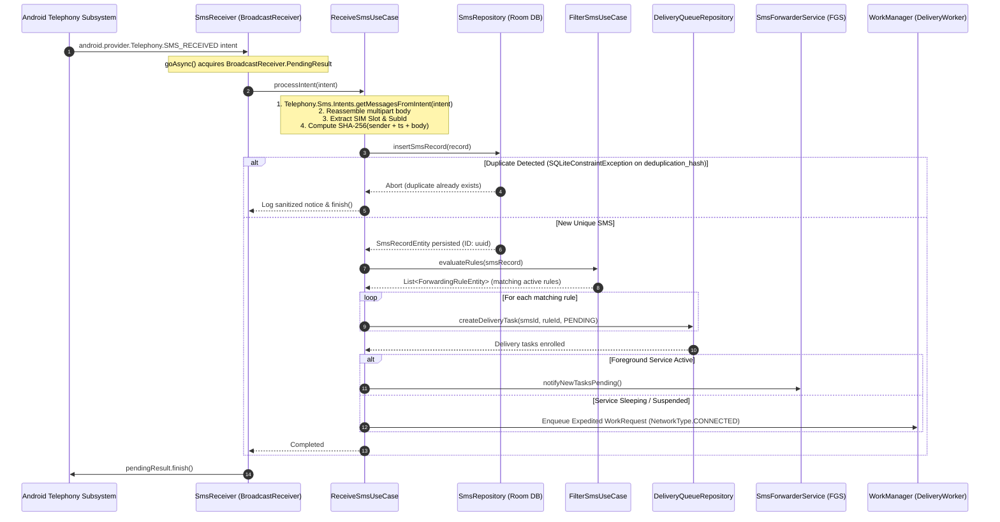
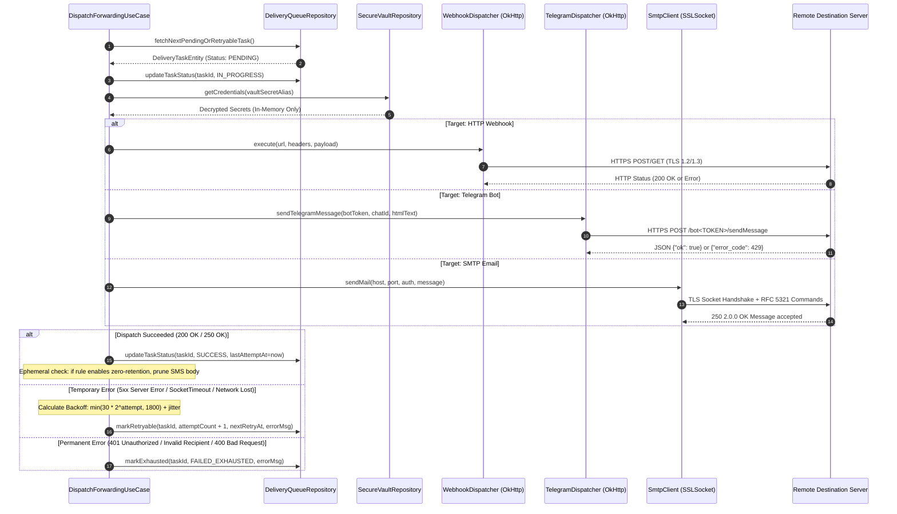
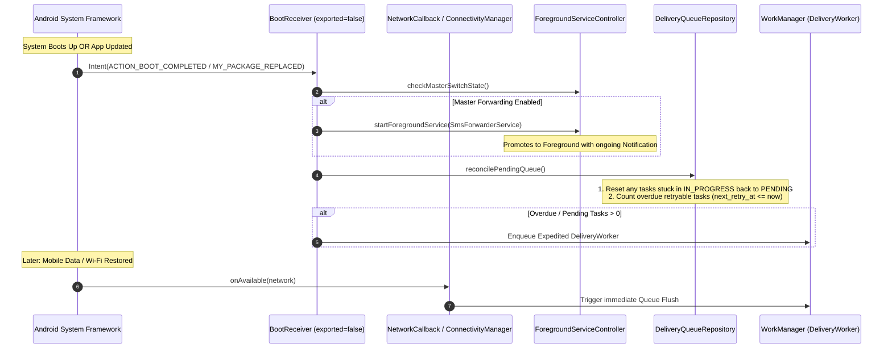

# Phase 2: System Architecture & Technology Stack Specification

**Project:** Personal Android SMS Forwarder  
**Document ID:** ARCH-PH2-SPEC-01  
**Author:** Engineer (`agent-83113a2c-0243-469e-8242-ed86c887356c`)  
**Phase:** Phase 2 — System Architecture & Technology Selection  
**Target Environment:** Android 8.0 (API 26) through Android 15 (API 35)  
**Distribution:** Personal Sideloaded APK  
**Classification:** Technical Blueprint & Implementation Standard  

---

## 1. Executive Summary & Architectural Overview

The **Personal Android SMS Forwarder** is a standalone, sovereign Android application engineered to capture incoming SMS messages on modern Android devices (dual-SIM, multipart PDU) and dispatch them to user-defined endpoints (HTTP Webhooks, Telegram Bot API, and SMTP Email) with zero reliance on intermediary cloud servers or third-party telemetry.

### Architectural Philosophy
1. **Uncompromising Privacy & Sovereignty:** Zero third-party SDKs (no Firebase, Crashlytics, Sentry, or tracking). Secrets are hardware-isolated using the Android Keystore (`MasterKey` + `EncryptedSharedPreferences`). SMS bodies and OTP codes are redacted from logs and UI notifications.
2. **Resilience & Zero-Miss Forwarding:** A hybrid execution topology combines a persistent Foreground Service (`specialUse`) with AndroidX `WorkManager` Expedited CoroutineWorkers. Delivery tasks are persisted in a transactional Room SQLite queue with deterministic exponential backoff and full jitter.
3. **Clean Architecture Separation:** Strict unidirectional dependency flow:
   `presentation` -> `engine` -> `domain` <- `data` <- `core`.
   Domain entities and use cases contain no Android framework dependencies, ensuring high testability and isolation.
4. **Lightweight Native Protocols:** Custom native Kotlin `SSLSocket` SMTP client over TLS/STARTTLS eliminating JavaMail/Jakarta Mail overhead; direct OkHttp 4.12.0 client for Webhook and Telegram APIs with strict TLS 1.2/1.3 connection specifications.

---

## 2. Layered Architecture & Modular Package Structure

```
+---------------------------------------------------------------------------------------+
|                                    PRESENTATION LAYER                                 |
|   Jetpack Compose UI | Material 3 | ViewModels (StateFlow) | Navigation Compose        |
+-------------------------------------------+-------------------------------------------+
                                            | Observes State / Dispatches Intents
                                            v
+---------------------------------------------------------------------------------------+
|                                      ENGINE LAYER                                     |
|  - SmsReceiver (Priority 999 BroadcastReceiver, Telephony.Sms.Intents)                |
|  - SmsForwarderService (Foreground Service type="specialUse", ongoing notification)  |
|  - DeliveryWorker (WorkManager Expedited CoroutineWorker, Constraints: Network)       |
|  - BootReceiver (BOOT_COMPLETED, MY_PACKAGE_REPLACED queue reconciler)                |
|  - RetentionPrunerWorker (Daily periodic DB cleanup)                                  |
+-------------------------------------------+-------------------------------------------+
                                            | Executes Use Cases
                                            v
+---------------------------------------------------------------------------------------+
|                                      DOMAIN LAYER                                     |
|  - Models: SmsMessage, ForwardingRule, DeliveryTask, ProtocolResult, VaultSecret      |
|  - Repository Interfaces: SmsRepository, RuleRepository, DeliveryQueueRepository,     |
|                           SecureVaultRepository, DeviceStateRepository               |
|  - Use Cases:                                                                         |
|      * ReceiveSmsUseCase                                                              |
|      * FilterSmsUseCase                                                               |
|      * EnqueueForwardingUseCase                                                       |
|      * DispatchForwardingUseCase                                                      |
|      * RetryFailedTasksUseCase                                                        |
|      * PruneHistoricalDataUseCase                                                     |
|      * TestDestinationConnectionUseCase                                               |
|      * ExportConfigurationUseCase / ImportConfigurationUseCase                        |
|      * WipeAllDataUseCase                                                             |
+---------------------+-------------------------------------+---------------------------+
                      ^                                     ^
                      | Implements Interfaces               | Implements Interfaces
+---------------------+-------------------+   +-------------+---------------------------+
|                     DATA LAYER          |   |                 CORE / COMMON           |
|  - Room Database & DAOs                 |   |  - DispatcherProvider (IO, Default, Main)|
|  - Entity Mappings & TypeConverters     |   |  - AppResult<T> / DomainError           |
|  - SecureVaultRepositoryImpl            |   |  - SecurityLogTree (Sanitizing Logger)  |
|    (EncryptedSharedPreferences)         |   |  - SecurityConstants                    |
|  - Network Clients:                     |   |  - StringRedactor & OTP Masker          |
|    * WebhookDispatcher (OkHttp)         |   |  - RegexMatcher                         |
|    * TelegramDispatcher (OkHttp)        |   +-----------------------------------------+
|    * SmtpClient (Native SSLSocket)      |
+-----------------------------------------+
```

### 2.1 Package Hierarchy (`com.smsforwarder.app`)

```
com.smsforwarder.app
├── SmsForwarderApp.kt                      // Application subclass: Timber init, Notification channels
├── core
│   ├── common
│   │   ├── AppResult.kt                    // Sealed hierarchy: Success, Failure(DomainError)
│   │   ├── DispatcherProvider.kt           // Standard & Test CoroutineDispatchers
│   │   └── NetworkConstants.kt             // Timeouts, buffer limits, TLS parameters
│   └── security
│       ├── SecurityLogTree.kt              // Production Timber tree with strict redaction
│       ├── Redactor.kt                     // Regex-based OTP/Token/Phone masking utility
│       └── CryptographicVault.kt           // Keystore master key wrapper interface
├── data
│   ├── local
│   │   ├── db
│   │   │   ├── AppDatabase.kt              // RoomDatabase definition (version 1)
│   │   │   ├── dao
│   │   │   │   ├── SmsRecordDao.kt         // Queries for SMS history and deduplication
│   │   │   │   ├── ForwardingRuleDao.kt    // CRUD for active forwarding rules
│   │   │   │   └── DeliveryTaskDao.kt      // Queue queries, status transitions, retries
│   │   │   ├── entity
│   │   │   │   ├── SmsRecordEntity.kt      // Inbound SMS persistence
│   │   │   │   ├── ForwardingRuleEntity.kt // Rule definitions & filter criteria
│   │   │   │   └── DeliveryTaskEntity.kt   // Outbound delivery task queue
│   │   │   └── converter
│   │   │       ├── DestinationTypeConverters.kt
│   │   │       └── StringListConverters.kt
│   │   └── vault
│   │       ├── SecureVaultDataSource.kt    // Direct EncryptedSharedPreferences wrapper
│   │       └── VaultKeyProvider.kt         // Key alias derivation conventions
│   ├── remote
│   │   ├── http
│   │   │   ├── OkHttpClientFactory.kt      // TLS 1.2/1.3, strict ConnectionSpec, No-body logger
│   │   │   ├── WebhookNetworkClient.kt     // OkHttp dynamic POST/GET request dispatcher
│   │   │   └── TelegramNetworkClient.kt    // Telegram Bot API sendMessage wrapper
│   │   └── smtp
│   │       ├── SmtpClient.kt               // Native Kotlin SSLSocket client (STARTTLS / Implicit TLS)
│   │       ├── SmtpSession.kt              // Handshake, EHLO, AUTH LOGIN/PLAIN, DATA streaming
│   │       └── SmtpCommandResponse.kt      // RFC 5321 command/response codes parser
│   └── repository
│       ├── SmsRepositoryImpl.kt
│       ├── ForwardingRuleRepositoryImpl.kt
│       ├── DeliveryQueueRepositoryImpl.kt
│       └── SecureVaultRepositoryImpl.kt
├── domain
│   ├── model
│   │   ├── SmsMessage.kt                   // Domain representation of intercepted SMS
│   │   ├── SimInfo.kt                      // Multi-SIM slot, subscription ID, carrier
│   │   ├── ForwardingRule.kt               // Rule entity with filter rules & target type
│   │   ├── DeliveryTask.kt                 // Queue item with state machine status
│   │   ├── DestinationType.kt              // Enum: WEBHOOK, TELEGRAM, EMAIL
│   │   ├── TaskStatus.kt                   // Enum: PENDING, IN_PROGRESS, SUCCESS, FAILED_RETRYABLE, EXHAUSTED
│   │   └── DestinationSecrets.kt           // Sealed classes: WebhookSecrets, TelegramSecrets, SmtpSecrets
│   ├── repository
│   │   ├── SmsRepository.kt
│   │   ├── ForwardingRuleRepository.kt
│   │   ├── DeliveryQueueRepository.kt
│   │   └── SecureVaultRepository.kt
│   └── usecase
│       ├── ReceiveSmsUseCase.kt            // PDU ingestion, reassembly, deduplication
│       ├── FilterSmsUseCase.kt             // Rule matching (allowlist, blocklist, regex, SIM slot)
│       ├── EnqueueForwardingUseCase.kt     // Generates DeliveryTasks from matching rules
│       ├── DispatchForwardingUseCase.kt    // Protocol dispatch (Webhook, Telegram, SMTP)
│       ├── RetryPendingTasksUseCase.kt     // Pulls retryable tasks past nextRetryAt
│       ├── TestDestinationUseCase.kt       // End-to-end configuration test without real SMS
│       ├── PruneHistoryUseCase.kt          // Deletes records older than retention window
│       └── WipeAllDataUseCase.kt           // Complete factory reset & Keystore purge
├── engine
│   ├── receiver
│   │   ├── SmsReceiver.kt                  // Priority 999 BroadcastReceiver with goAsync()
│   │   └── BootReceiver.kt                 // BOOT_COMPLETED & MY_PACKAGE_REPLACED handler
│   ├── service
│   │   ├── SmsForwarderService.kt          // Sticky Foreground Service (specialUse)
│   │   └── NotificationHelper.kt           // Ongoing persistent status notification channel
│   └── worker
│       ├── WorkManagerScheduler.kt         // Schedules expedited and periodic workers
│       ├── DeliveryWorker.kt               // Expedited CoroutineWorker for retries & fallback
│       └── RetentionPrunerWorker.kt        // Daily periodic cleanup worker
└── presentation
    ├── MainActivity.kt                     // Single-activity Jetpack Compose host
    ├── navigation
    │   ├── Screen.kt                       // Destinations: Dashboard, Rules, Logs, Settings
    │   └── AppNavHost.kt                   // Navigation graph
    ├── dashboard
    │   ├── DashboardScreen.kt              // Master toggle, metrics, recent events
    │   └── DashboardViewModel.kt
    ├── rules
    │   ├── RuleListScreen.kt               // Overview of configured destinations
    │   ├── RuleEditorScreen.kt             // Form: Webhook, Telegram, or Email configuration
    │   └── RuleEditorViewModel.kt
    ├── logs
    │   ├── DeliveryLogScreen.kt            // Queue items, status filters, manual retry, error inspection
    │   └── DeliveryLogViewModel.kt
    ├── settings
    │   ├── SettingsScreen.kt               // Retention slider, Panic wipe button, SIM info
    │   └── SettingsViewModel.kt
    ├── component
    │   ├── AppTopBar.kt
    │   ├── StatusBadge.kt
    │   ├── ConfirmationDialog.kt
    │   └── SecretInputField.kt             // Password masked input with secure clipboard clear
    └── theme
        ├── Color.kt
        ├── Theme.kt
        └── Type.kt
```

---

## 3. Technology Stack Selection & Bill of Materials (BOM)

### 3.1 Android Platform SDK Targets
- **`minSdk`:** `26` (Android 8.0 Oreo). Guarantees baseline support for `SubscriptionManager`, modern notification channels, Android Keystore AES-GCM, and `Telephony.Sms.Intents`.
- **`compileSdk`:** `35` (Android 15). Required for latest compilation checks and foreground service contract enforcement.
- **`targetSdk`:** `35` (Android 15). Complies with Android 14/15 background execution constraints, 16 KB page alignment compatibility, and granular foreground service type requirements.

### 3.2 Bill of Materials & Library Selections

| Category | Library / Dependency | Version | Justification / Architectural Role |
| :--- | :--- | :--- | :--- |
| **Language & Tooling** | Kotlin Standard Library | `2.0.21` | Modern Kotlin compiler with K2 engine support. |
| **Compiler Plugin** | Kotlin Compose Compiler | Integrated in Kotlin 2.0+ | Official Compose compiler plugin embedded in Kotlin 2.0+. |
| **UI Toolkit** | Jetpack Compose BOM | `2024.10.01` | Pure declarative UI, reactive state management, zero XML overhead. |
| **UI Components** | Material 3 (`material3`) | `1.3.1` | Modern Material You components, dynamic theming, accessibility. |
| **Architecture / Lifecycle** | Lifecycle ViewModel Compose | `2.8.7` | `viewModelScope`, `collectAsStateWithLifecycle()` for reactive UI state. |
| **Navigation** | Navigation Compose | `2.8.4` | Single-activity type-safe composable screen routing. |
| **Persistence (DB)** | AndroidX Room (`runtime`, `ktx`) | `2.6.1` | Local SQLite ORM with Coroutine Flow support and strict migration paths. |
| **KSP Code Gen** | Google KSP | `2.0.21-1.0.27` | High-performance annotation processing for Room and Serialization. |
| **Concurrency** | Kotlinx Coroutines (`android`, `core`)| `1.9.0` | Asynchronous structured concurrency, Dispatchers, and StateFlows. |
| **Security & Crypto** | AndroidX Security Crypto (`security-crypto`) | `1.1.0-alpha06` | Android Keystore backed `EncryptedSharedPreferences` with `MasterKey` AES-256-GCM. |
| **Background Scheduling** | AndroidX WorkManager (`work-runtime-ktx`) | `2.10.0` | Expedited CoroutineWorkers, battery-aware constraints, retry guarantees. |
| **HTTP & Telegram Client** | Square OkHttp | `4.12.0` | Connection pooling, HTTP/2, TLS 1.2/1.3 enforcement, zero reflection. |
| **Serialization** | Kotlinx Serialization (`kotlinx-serialization-json`) | `1.7.3` | Reflection-free, lightweight JSON parsing/formatting for templates and Telegram payloads. |
| **Email Protocol** | **Custom Native Kotlin SSLSocket Client** | **Internal** | Zero dependencies. Bypasses 64k DEX bloat, AWT dependencies, and ProGuard reflection breaks of JavaMail. |
| **Logging** | Jake Wharton Timber | `5.0.1` | Extensible logger redirected to custom `SecurityLogTree` with regex masking. |
| **Testing** | JUnit 4 / MockK / Turbine / Coroutines Test | `4.13.2` / `1.13.13` / `1.2.0` / `1.9.0` | Unit testing use cases, database DAOs, and coroutine state streams. |

### 3.3 Strict Forbidden Dependencies (Auditor Zero-Telemetry Compliance)
The following libraries are **explicitly barred** from Gradle configuration:
- ❌ `com.google.firebase:*` (Firebase Analytics, Crashlytics, Core)
- ❌ `io.sentry:*` (Sentry error reporting)
- ❌ `com.microsoft.appcenter:*` (AppCenter telemetry)
- ❌ `com.facebook.android:*` (Facebook tracking)
- ❌ Any commercial advertising or analytics SDK.

---

## 4. Gradle Build Specifications (`build.gradle.kts`)

### 4.1 Version Catalog (`gradle/libs.versions.toml`)

```toml
[versions]
agp = "8.7.2"
kotlin = "2.0.21"
ksp = "2.0.21-1.0.27"
compose-bom = "2024.10.01"
androidx-lifecycle = "2.8.7"
androidx-navigation = "2.8.4"
androidx-room = "2.6.1"
androidx-security-crypto = "1.1.0-alpha06"
androidx-work = "2.10.0"
coroutines = "1.9.0"
okhttp = "4.12.0"
kotlinx-serialization = "1.7.3"
timber = "5.0.1"
junit = "4.13.2"
mockk = "1.13.13"
turbine = "1.2.0"

[libraries]
# Kotlin & Coroutines
kotlin-stdlib = { group = "org.jetbrains.kotlin", name = "kotlin-stdlib", version.ref = "kotlin" }
coroutines-core = { group = "org.jetbrains.kotlinx", name = "kotlinx-coroutines-core", version.ref = "coroutines" }
coroutines-android = { group = "org.jetbrains.kotlinx", name = "kotlinx-coroutines-android", version.ref = "coroutines" }
kotlinx-serialization-json = { group = "org.jetbrains.kotlinx", name = "kotlinx-serialization-json", version.ref = "kotlinx-serialization" }

# Compose BOM & UI
compose-bom = { group = "androidx.compose", name = "compose-bom", version.ref = "compose-bom" }
compose-ui = { group = "androidx.compose.ui", name = "ui" }
compose-ui-graphics = { group = "androidx.compose.ui", name = "ui-graphics" }
compose-ui-tooling-preview = { group = "androidx.compose.ui", name = "ui-tooling-preview" }
compose-material3 = { group = "androidx.compose.material3", name = "material3" }
compose-navigation = { group = "androidx.navigation", name = "navigation-compose", version.ref = "androidx-navigation" }
lifecycle-viewmodel-compose = { group = "androidx.lifecycle", name = "lifecycle-viewmodel-compose", version.ref = "androidx-lifecycle" }
lifecycle-runtime-compose = { group = "androidx.lifecycle", name = "lifecycle-runtime-compose", version.ref = "androidx-lifecycle" }

# Persistence & Room
room-runtime = { group = "androidx.room", name = "room-runtime", version.ref = "androidx-room" }
room-ktx = { group = "androidx.room", name = "room-ktx", version.ref = "androidx-room" }
room-compiler = { group = "androidx.room", name = "room-compiler", version.ref = "androidx-room" }

# Security & Crypto
security-crypto = { group = "androidx.security", name = "security-crypto", version.ref = "androidx-security-crypto" }

# Background Processing
workmanager-runtime-ktx = { group = "androidx.work", name = "work-runtime-ktx", version.ref = "androidx-work" }

# Networking
okhttp = { group = "com.squareup.okhttp3", name = "okhttp", version.ref = "okhttp" }

# Utilities & Logging
timber = { group = "com.jakewharton.timber", name = "timber", version.ref = "timber" }

# Testing
test-junit = { group = "junit", name = "junit", version.ref = "junit" }
test-mockk = { group = "io.mockk", name = "mockk", version.ref = "mockk" }
test-turbine = { group = "app.cash.turbine", name = "turbine", version.ref = "turbine" }
test-coroutines = { group = "org.jetbrains.kotlinx", name = "kotlinx-coroutines-test", version.ref = "coroutines" }

[plugins]
android-application = { id = "com.android.application", version.ref = "agp" }
kotlin-android = { id = "org.jetbrains.kotlin.android", version.ref = "kotlin" }
kotlin-compose = { id = "org.jetbrains.kotlin.plugin.compose", version.ref = "kotlin" }
kotlin-serialization = { id = "org.jetbrains.kotlin.plugin.serialization", version.ref = "kotlin" }
ksp = { id = "com.google.devtools.ksp", version.ref = "ksp" }
```

### 4.2 Application Module Build Script (`app/build.gradle.kts`)

```kotlin
plugins {
    alias(libs.plugins.android.application)
    alias(libs.plugins.kotlin.android)
    alias(libs.plugins.kotlin.compose)
    alias(libs.plugins.kotlin.serialization)
    alias(libs.plugins.ksp)
}

android {
    namespace = "com.smsforwarder.app"
    compileSdk = 35

    defaultConfig {
        applicationId = "com.smsforwarder.app"
        minSdk = 26
        targetSdk = 35
        versionCode = 1
        versionName = "1.0.0"

        testInstrumentationRunner = "androidx.test.runner.AndroidJUnitRunner"
        vectorDrawables {
            useSupportLibrary = true
        }

        // Room schema export for migration verification
        ksp {
            arg("room.schemaLocation", "$projectDir/schemas")
            arg("room.incremental", "true")
            arg("room.expandProjection", "true")
        }
    }

    buildTypes {
        release {
            isMinifyEnabled = true
            isShrinkResources = true
            proguardFiles(
                getDefaultProguardFile("proguard-android-optimize.txt"),
                "proguard-rules.pro"
            )
            signingConfig = signingConfigs.getByName("debug") // Default personal sideload
        }
        debug {
            applicationIdSuffix = ".debug"
            isDebuggable = true
        }
    }

    compileOptions {
        sourceCompatibility = JavaVersion.VERSION_17
        targetCompatibility = JavaVersion.VERSION_17
    }

    kotlinOptions {
        jvmTarget = "17"
        freeCompilerArgs += listOf(
            "-opt-in=kotlinx.coroutines.ExperimentalCoroutinesApi",
            "-opt-in=androidx.compose.material3.ExperimentalMaterial3Api"
        )
    }

    buildFeatures {
        compose = true
        buildConfig = true
    }

    packaging {
        resources {
            excludes += listOf(
                "/META-INF/{AL2.0,LGPL2.1}",
                "/META-INF/INDEX.LIST",
                "/META-INF/DEPENDENCIES"
            )
        }
    }
}

dependencies {
    implementation(libs.kotlin.stdlib)
    implementation(libs.coroutines.core)
    implementation(libs.coroutines.android)
    implementation(libs.kotlinx.serialization.json)

    // Jetpack Compose
    implementation(platform(libs.compose.bom))
    implementation(libs.compose.ui)
    implementation(libs.compose.ui.graphics)
    implementation(libs.compose.ui.tooling.preview)
    implementation(libs.compose.material3)
    implementation(libs.compose.navigation)
    implementation(libs.lifecycle.viewmodel.compose)
    implementation(libs.lifecycle.runtime.compose)

    // Local Storage & Room
    implementation(libs.room.runtime)
    implementation(libs.room.ktx)
    ksp(libs.room.compiler)

    // Security & Keystore
    implementation(libs.security.crypto)

    // WorkManager
    implementation(libs.workmanager.runtime.ktx)

    // Network & Protocols
    implementation(libs.okhttp)

    // Logging
    implementation(libs.timber)

    // Testing
    testImplementation(libs.test.junit)
    testImplementation(libs.test.mockk)
    testImplementation(libs.test.turbine)
    testImplementation(libs.test.coroutines)
}
```

---

## 5. Data Model & Database Schemas (Room & Vault)

To comply with Auditor's **Isolated Storage Architecture** security invariant, application state is decoupled:
- **Operational Data & History:** SQLite via AndroidX Room (`sms_forwarder.db`).
- **Credentials & API Keys:** Android Keystore via `EncryptedSharedPreferences` (`secure_forwarder_vault.xml`).
- **Invariant:** Room entities **never** store plaintext tokens, passwords, or Authorization headers. They store opaque string alias references (`vaultAliasRef`).

### 5.1 Room Database Entities

```
+---------------------------------------------------------------------------------+
|                                 Room Database: sms_forwarder.db                 |
+---------------------------------------------------------------------------------+
|                                                                                 |
|  +---------------------------+       1:N       +-----------------------------+  |
|  |       sms_records         | <-------------> |        delivery_tasks       |  |
|  +---------------------------+                 +-----------------------------+  |
|  | PK id (UUID)              |                 | PK id (UUID)                |  |
|  | sender                    |                 | FK sms_record_id (Cascade)  |  |
|  | raw_body                  |                 | FK rule_id (Set Null)       |  |
|  | timestamp_millis          |                 | destination_type            |  |
|  | sim_slot_index (0/1/-1)   |                 | destination_endpoint        |  |
|  | sub_id                    |                 | status                      |  |
|  | carrier_name              |                 | attempt_count               |  |
|  | deduplication_hash (UQ)   |                 | last_attempt_at             |  |
|  | created_at                |                 | next_retry_at               |  |
|  +---------------------------+                 | error_message               |  |
|                                                | vault_secret_alias          |  |
|                                                | created_at                  |  |
|                                                +-----------------------------+  |
|                                                               ^                 |
|  +---------------------------+                                |                 |
|  |     forwarding_rules      | -------------------------------+ (Evaluates To)  |
|  +---------------------------+                                                  |
|  | PK id (UUID)              |                                                  |
|  | name                      |                                                  |
|  | is_enabled                |                                                  |
|  | target_destination_type   |                                                  |
|  | destination_endpoint      |                                                  |
|  | sender_filter_type        |                                                  |
|  | sender_filter_values (CSV)|                                                  |
|  | keyword_filter_values(CSV)|                                                  |
|  | sim_slot_filter (-1/0/1)  |                                                  |
|  | custom_template           |                                                  |
|  | vault_alias_ref           |                                                  |
|  | created_at                |                                                  |
|  | updated_at                |                                                  |
|  +---------------------------+                                                  |
+---------------------------------------------------------------------------------+
```

#### 5.1.1 `SmsRecordEntity`
Stores inbound SMS messages reassembled from cellular PDUs.

```kotlin
package com.smsforwarder.app.data.local.db.entity

import androidx.room.ColumnInfo
import androidx.room.Entity
import androidx.room.Index
import androidx.room.PrimaryKey
import java.util.UUID

@Entity(
    tableName = "sms_records",
    indices = [
        Index(value = ["deduplication_hash"], unique = true),
        Index(value = ["timestamp_millis"]),
        Index(value = ["created_at"])
    ]
)
data class SmsRecordEntity(
    @PrimaryKey
    @ColumnInfo(name = "id")
    val id: String = UUID.randomUUID().toString(),

    @ColumnInfo(name = "sender")
    val sender: String, // E.164 phone number or alphanumeric sender ID

    @ColumnInfo(name = "raw_body")
    val rawBody: String, // Fully reassembled SMS body text

    @ColumnInfo(name = "timestamp_millis")
    val timestampMillis: Long, // Origination timestamp from telephonic service center

    @ColumnInfo(name = "sim_slot_index")
    val simSlotIndex: Int, // 0 = SIM 1, 1 = SIM 2, -1 = Unknown / Default

    @ColumnInfo(name = "sub_id")
    val subId: Int, // SubscriptionManager subscription ID

    @ColumnInfo(name = "carrier_name")
    val carrierName: String?, // Operator display name, e.g. "T-Mobile", "Vodafone"

    @ColumnInfo(name = "deduplication_hash")
    val deduplicationHash: String, // SHA-256(sender + ":" + timestamp_millis + ":" + raw_body)

    @ColumnInfo(name = "created_at")
    val createdAt: Long = System.currentTimeMillis()
)
```

#### 5.1.2 `ForwardingRuleEntity`
Defines routing and filtering policies configured by the user.

```kotlin
package com.smsforwarder.app.data.local.db.entity

import androidx.room.ColumnInfo
import androidx.room.Entity
import androidx.room.Index
import androidx.room.PrimaryKey
import java.util.UUID

enum class DestinationType {
    WEBHOOK,
    TELEGRAM,
    EMAIL
}

enum class SenderFilterType {
    ALL,       // Match any sender
    ALLOWLIST, // Match ONLY senders in filter values
    BLOCKLIST  // Match all EXCEPT senders in filter values
}

@Entity(
    tableName = "forwarding_rules",
    indices = [
        Index(value = ["is_enabled"]),
        Index(value = ["target_destination_type"])
    ]
)
data class ForwardingRuleEntity(
    @PrimaryKey
    @ColumnInfo(name = "id")
    val id: String = UUID.randomUUID().toString(),

    @ColumnInfo(name = "name")
    val name: String, // User-friendly label, e.g., "Bank OTP to Telegram"

    @ColumnInfo(name = "is_enabled")
    val isEnabled: Boolean = true,

    @ColumnInfo(name = "target_destination_type")
    val targetDestinationType: DestinationType,

    @ColumnInfo(name = "destination_endpoint")
    val destinationEndpoint: String, // URL, Telegram Chat ID, or Recipient Email

    @ColumnInfo(name = "sender_filter_type")
    val senderFilterType: SenderFilterType = SenderFilterType.ALL,

    @ColumnInfo(name = "sender_filter_values")
    val senderFilterValues: String = "", // Comma-separated or newline-delimited numbers/IDs

    @ColumnInfo(name = "keyword_filter_values")
    val keywordFilterValues: String = "", // Comma-separated search keywords (case-insensitive)

    @ColumnInfo(name = "sim_slot_filter")
    val simSlotFilter: Int = -1, // -1 = Any SIM, 0 = SIM 1 only, 1 = SIM 2 only

    @ColumnInfo(name = "custom_template")
    val customTemplate: String? = null, // Customizable message format, e.g. "{{body}} from {{sender}}"

    @ColumnInfo(name = "vault_alias_ref")
    val vaultAliasRef: String, // Pointer to EncryptedSharedPreferences key group

    @ColumnInfo(name = "created_at")
    val createdAt: Long = System.currentTimeMillis(),

    @ColumnInfo(name = "updated_at")
    val updatedAt: Long = System.currentTimeMillis()
)
```

#### 5.1.3 `DeliveryTaskEntity`
Represents an individual outbound forwarding job dispatched to an endpoint.

```kotlin
package com.smsforwarder.app.data.local.db.entity

import androidx.room.ColumnInfo
import androidx.room.Entity
import androidx.room.ForeignKey
import androidx.room.Index
import androidx.room.PrimaryKey
import java.util.UUID

enum class TaskStatus {
    PENDING,            // Created, queued for immediate dispatch
    IN_PROGRESS,        // Socket/HTTP connection currently active
    SUCCESS,            // Destination acknowledged with 200 OK / 250 OK
    FAILED_RETRYABLE,   // Temporary network error / timeout; eligible for backoff retry
    FAILED_EXHAUSTED    // Maximum retry attempts reached or fatal non-retryable error (e.g. 401 Unauthorized)
}

@Entity(
    tableName = "delivery_tasks",
    foreignKeys = [
        ForeignKey(
            entity = SmsRecordEntity::class,
            parentColumns = ["id"],
            childColumns = ["sms_record_id"],
            onDelete = ForeignKey.CASCADE
        ),
        ForeignKey(
            entity = ForwardingRuleEntity::class,
            parentColumns = ["id"],
            childColumns = ["rule_id"],
            onDelete = ForeignKey.SET_NULL
        )
    ],
    indices = [
        Index(value = ["sms_record_id"]),
        Index(value = ["rule_id"]),
        Index(value = ["status", "next_retry_at"]),
        Index(value = ["created_at"])
    ]
)
data class DeliveryTaskEntity(
    @PrimaryKey
    @ColumnInfo(name = "id")
    val id: String = UUID.randomUUID().toString(),

    @ColumnInfo(name = "sms_record_id")
    val smsRecordId: String,

    @ColumnInfo(name = "rule_id")
    val ruleId: String?,

    @ColumnInfo(name = "destination_type")
    val destinationType: DestinationType,

    @ColumnInfo(name = "destination_endpoint")
    val destinationEndpoint: String,

    @ColumnInfo(name = "status")
    val status: TaskStatus = TaskStatus.PENDING,

    @ColumnInfo(name = "attempt_count")
    val attemptCount: Int = 0,

    @ColumnInfo(name = "last_attempt_at")
    val lastAttemptAt: Long? = null,

    @ColumnInfo(name = "next_retry_at")
    val nextRetryAt: Long? = null, // Timestamp for next backoff execution

    @ColumnInfo(name = "error_message")
    val errorMessage: String? = null, // Sanitized error summary (never contains credentials)

    @ColumnInfo(name = "vault_secret_alias")
    val vaultSecretAlias: String, // EncryptedSharedPreferences key alias to fetch secrets

    @ColumnInfo(name = "created_at")
    val createdAt: Long = System.currentTimeMillis()
)
```

---

### 5.2 Secure Vault Schema (`EncryptedSharedPreferences`)

Vault keys use a deterministic namespace tied to the rule's `vaultAliasRef` (e.g., `rule_{ruleId}`).

```
EncryptedSharedPreferences: "secure_forwarder_vault.xml"
MasterKey: "_sms_forwarder_master_key_" (AES-256-GCM, StrongBox enabled if available)
Encryption: AES256_SIV (Keys), AES256_GCM (Values)
```

#### Key-Value Mappings Table

| Target Type | Vault Key Pattern | Data Stored | Example / Description |
| :--- | :--- | :--- | :--- |
| **Telegram** | `vault_{alias}_tg_bot_token` | Plaintext Bot Token | `7123456789:ABCdefGhIJKlmNoPQRsTUVwxyZ` |
| **Webhook** | `vault_{alias}_wh_auth_header` | Authorization Header | `Bearer eyJhbGciOi...` or `Basic dXNlcjpwYXNz` |
| **Webhook** | `vault_{alias}_wh_custom_headers` | JSON Map of Headers | `{"X-API-Key": "secret_key_123", "X-Service": "SmsEngine"}` |
| **Email (SMTP)** | `vault_{alias}_smtp_host` | Hostname / IP | `smtp.gmail.com` |
| **Email (SMTP)** | `vault_{alias}_smtp_port` | Port number string | `465` (SSL) or `587` (STARTTLS) |
| **Email (SMTP)** | `vault_{alias}_smtp_username` | Auth Username | `user@example.com` |
| **Email (SMTP)** | `vault_{alias}_smtp_password` | App Password / Secret| `abcd efgh ijkl mnop` |
| **Email (SMTP)** | `vault_{alias}_smtp_from` | Sender From address | `alerts@example.com` |

#### Cryptographic MasterKey Initialization Specification

```kotlin
package com.smsforwarder.app.data.local.vault

import android.content.Context
import android.content.SharedPreferences
import androidx.security.crypto.EncryptedSharedPreferences
import androidx.security.crypto.MasterKey
import timber.log.Timber

class SecureVaultDataSource(context: Context) {

    private val masterKey = MasterKey.Builder(context, MASTER_KEY_ALIAS)
        .setKeyScheme(MasterKey.KeyScheme.AES256_GCM)
        .setRequestStrongBoxStorage(true)
        .setUserAuthenticationRequired(false) // Critical: do NOT bind to biometric/lockscreen
        .build()

    val vault: SharedPreferences = try {
        createEncryptedPrefs(context, masterKey)
    } catch (e: Exception) {
        Timber.e(e, "EncryptedSharedPreferences corrupted. Recovering clean instance.")
        // Emergency recovery: Clear corrupted file to prevent infinite crash loop
        context.deleteSharedPreferences(VAULT_FILE_NAME)
        createEncryptedPrefs(context, masterKey)
    }

    private fun createEncryptedPrefs(context: Context, key: MasterKey): SharedPreferences {
        return EncryptedSharedPreferences.create(
            context,
            VAULT_FILE_NAME,
            key,
            EncryptedSharedPreferences.PrefKeyEncryptionScheme.AES256_SIV,
            EncryptedSharedPreferences.PrefValueEncryptionScheme.AES256_GCM
        )
    }

    companion object {
        private const val MASTER_KEY_ALIAS = "_sms_forwarder_master_key_"
        private const val VAULT_FILE_NAME = "secure_forwarder_vault"
    }
}
```

---

## 6. Execution Flow & Detailed Sequence Diagrams

### 6.1 Diagram 1: Inbound SMS Ingestion & Delivery Task Queue Creation

Shows reception through `SmsReceiver`, multipart PDU reassembly via `Telephony.Sms.Intents`, SHA-256 deduplication hashing, transactional Room insertion, rule evaluation, and dispatch triggering.



---

### 6.2 Diagram 2: Protocol Dispatch & Exponential Backoff Handling

Illustrates protocol execution (Webhook, Telegram, SMTP), response evaluation, status transitions, and exponential backoff jitter calculation.



#### Exponential Backoff Mathematical Specification
When a dispatch encounters a transient network failure, the next retry delay $T_{\text{retry}}$ is calculated using **Exponential Backoff with Full Jitter**:

$$\text{BaseDelay} = 30 \text{ seconds}$$
$$\text{MaxDelay} = 1800 \text{ seconds (30 minutes)}$$
$$\text{CappedDelay} = \min\left(\text{MaxDelay}, \text{BaseDelay} \times 2^{\text{attemptCount}}\right)$$
$$T_{\text{retry}} = \text{CurrentTime} + \text{UniformRandom}\left(\frac{\text{CappedDelay}}{2}, \text{CappedDelay}\right)$$

Maximum retry attempts before transitioning to `FAILED_EXHAUSTED`: **5 attempts**.

---

### 6.3 Diagram 3: Device Reboot (`BOOT_COMPLETED`) & Network Recovery Reconciliation

Illustrates state restoration after power cycles, software updates, or network reconnection events.



---

## 7. Protocol Integration Client Architectures

### 7.1 HTTP Webhook & Telegram Architecture (OkHttp 4.12.0)

#### Shared Strict OkHttp Client Configuration
In adherence with the Security Threat Model:
1. `cleartextTrafficPermitted` is disabled system-wide.
2. Connection specifications enforce TLS 1.2 and TLS 1.3 only.
3. Http logging interceptor is set to `Level.NONE` or `Level.BASIC` (URLs stripped of bot tokens).

```kotlin
package com.smsforwarder.app.data.remote.http

import okhttp3.CipherSuite
import okhttp3.ConnectionSpec
import okhttp3.OkHttpClient
import okhttp3.TlsVersion
import java.util.concurrent.TimeUnit

object OkHttpClientFactory {

    private val strictTlsSpec = ConnectionSpec.Builder(ConnectionSpec.MODERN_TLS)
        .tlsVersions(TlsVersion.TLS_1_3, TlsVersion.TLS_1_2)
        .cipherSuites(
            CipherSuite.TLS_ECDHE_ECDSA_WITH_AES_256_GCM_SHA384,
            CipherSuite.TLS_ECDHE_RSA_WITH_AES_256_GCM_SHA384,
            CipherSuite.TLS_ECDHE_ECDSA_WITH_AES_128_GCM_SHA256,
            CipherSuite.TLS_ECDHE_RSA_WITH_AES_128_GCM_SHA256,
            CipherSuite.TLS_CHACHA20_POLY1305_SHA256
        )
        .build()

    fun createClient(): OkHttpClient {
        return OkHttpClient.Builder()
            .connectionSpecs(listOf(strictTlsSpec))
            .connectTimeout(15, TimeUnit.SECONDS)
            .readTimeout(15, TimeUnit.SECONDS)
            .writeTimeout(15, TimeUnit.SECONDS)
            .retryOnConnectionFailure(false) // Managed at Room queue layer
            .build()
    }
}
```

#### Telegram Payload Builder (HTML Mode)
To eliminate MarkdownV2 escaping crashes on arbitrary OTP characters (`_`, `*`, `[`, `]`, `(`, `)`, `~`, `` ` ``, `>`, `#`, `+`, `-`, `=`, `|`, `{`, `}`, `.`, `!`), Telegram messages are formatted strictly with **HTML tags**:

```kotlin
fun formatTelegramHtml(sender: String, simSlot: Int, timestamp: String, body: String): String {
    val escapedSender = escapeHtml(sender)
    val escapedBody = escapeHtml(body)
    val simLabel = if (simSlot >= 0) " [SIM ${simSlot + 1}]" else ""

    return "📬 <b>New SMS Received$simLabel</b>\n" +
           "👤 <b>From:</b> <code>$escapedSender</code>\n" +
           "🕒 <b>Time:</b> $timestamp\n\n" +
           "💬 <b>Message:</b>\n$escapedBody"
}

private fun escapeHtml(text: String): String {
    return text
        .replace("&", "&amp;")
        .replace("<", "&lt;")
        .replace(">", "&gt;")
}
```

---

### 7.2 Native Kotlin SSLSocket SMTP Client Architecture

To prevent adding legacy JavaMail/Jakarta Mail dependencies (which introduce ~6MB of JAR overhead, require AWT/Activation classes not present on Android, and suffer ProGuard/R8 reflection failures), the application implements a dedicated native Kotlin socket client.

#### Architecture Highlights:
- **Port 465:** Direct implicit SSL/TLS socket via `SSLSocketFactory.getDefault().createSocket()`.
- **Port 587:** Plain TCP socket upgraded to TLS via explicit `STARTTLS` handshake.
- **SNI & Hostname Verification:** Enforced via `sslParameters.endpointIdentificationAlgorithm = "HTTPS"`.
- **Authentication:** RFC 4954 `AUTH LOGIN` (Base64 username and password) and `AUTH PLAIN`.
- **Message Framing:** RFC 5322 MIME format with UTF-8 `Subject` and `body` encoding, and dot-stuffing termination (`\r\n.\r\n`).

```
+---------------------------------------------------------------------------------+
|                    Native Kotlin SSLSocket SMTP Protocol State Machine           |
+---------------------------------------------------------------------------------+
|                                                                                 |
|   [ Connect Socket ] ---> Reads 220 Service Ready Banner                        |
|          |                                                                      |
|          v                                                                      |
|   [ EHLO localhost ] ---> Reads 250 Features List                               |
|          |                                                                      |
|          +--- If Port 587 ---> Sends STARTTLS ---> 220 Start TLS Handshake      |
|          |                                         Re-issues EHLO localhost     |
|          v                                                                      |
|   [ AUTH LOGIN ]     ---> Sends Base64(Username) ---> 334 Password Challenge    |
|                      ---> Sends Base64(Password) ---> 235 Authentication Succeeded
|          |                                                                      |
|          v                                                                      |
|   [ MAIL FROM:<...> ] ---> 250 Sender OK                                        |
|          |                                                                      |
|          v                                                                      |
|   [ RCPT TO:<...> ]   ---> 250 Recipient OK                                     |
|          |                                                                      |
|          v                                                                      |
|   [ DATA ]            ---> 354 Start Mail Input                                 |
|          |                                                                      |
|          v                                                                      |
|   [ Stream RFC 5322 Headers + Body + "\r\n.\r\n" ] ---> 250 OK Message Accepted |
|          |                                                                      |
|          v                                                                      |
|   [ QUIT ]            ---> 221 Bye Socket Closed Cleanly                        |
+---------------------------------------------------------------------------------+
```

---

## 8. Android Background Execution & Lifecycle Hardening

### 8.1 Hybrid Execution Topology

```
+---------------------------------------------------------------------------------------+
|                               Android OS Background Reality                           |
|  - Aggressive OEM battery killers (MIUI, OneUI, ColorOS) terminate inactive processes |
|  - Android 14+ restricts background service starts without explicit FGS types         |
|  - Android Doze Mode restricts standard network alarms                                |
+---------------------------------------------------------------------------------------+
                                            |
                                            v
+---------------------------------------------------------------------------------------+
|                               HYBRID RESILIENCE MODEL                                 |
+---------------------------------------------------------------------------------------+
|  1. Persistent Foreground Service (type="specialUse"):                                |
|     - Shows persistent low-priority ongoing notification in notification drawer       |
|     - Keeps application process pinned in memory with high OOM priority score         |
|     - Binds real-time message processing directly upon SMS_RECEIVED broadcast         |
|                                                                                       |
|  2. AndroidX WorkManager Expedited CoroutineWorkers:                                  |
|     - Acts as guaranteed execution fallback if the Foreground Service is killed       |
|     - Handles delayed retries with NetworkType.CONNECTED constraints                  |
|     - Executes scheduled periodic pruning of historical logs                          |
|                                                                                       |
|  3. Battery Optimization Exemption:                                                   |
|     - Requests ACTION_REQUEST_IGNORE_BATTERY_OPTIMIZATIONS from user in UI setup      |
|     - Exempts app network sockets from Doze maintenance windows                       |
+---------------------------------------------------------------------------------------+
```

### 8.2 Foreground Service Manifest Declaration (Android 14/15 Compliant)

```xml
<service
    android:name=".engine.service.SmsForwarderService"
    android:exported="false"
    android:foregroundServiceType="specialUse">
    <property
        android:name="android.app.PROPERTY_SPECIAL_USE_FGS_SUBTYPE"
        android:value="Personal SMS Forwarding Service" />
</service>
```

---

## 9. Security & Privacy Invariants Implementation Plan

This section provides explicit implementation mechanisms addressing every audit checkpoint established in `PHASE_1_SECURITY_THREAT_MODEL.md`.

### 9.1 Verification Matrix: Phase 1 Security Invariants

| Invariant | Threat Vector Addressed | Architectural Guarantee & Implementation Detail |
| :--- | :--- | :--- |
| **Zero Plaintext Secrets** | Room DB extraction, memory dumps, root file inspection | `RoomDatabase` tables hold zero credentials. All tokens, passwords, and custom headers are encrypted in `secure_forwarder_vault.xml` via Android Keystore AES-256-GCM. Decrypted strings exist only ephemerally in function scopes during active socket streaming. |
| **No Biometric Lockout** | `KeyPermanentlyInvalidatedException` on lockscreen PIN changes | `MasterKey` configuration explicitly omits biometric/user-authentication binding (`setUserAuthenticationRequired(false)`). Background forwarding continues without interruption when the phone is locked. |
| **Strict Log Sanitization** | Logcat snooping, ADB bug reports, OEM logs | Production logging pipeline uses `SecurityLogTree`, which intercepts all Timber logs and passes messages through regex redactors that scrub bot tokens, Bearer headers, phone numbers, and potential OTPs before emitting to Android Log. |
| **Zero Third-Party Telemetry** | Supply-chain data exfiltration, privacy violations | Gradle dependencies audit: zero analytics SDKs, zero crash reporters, zero advertising libraries. Verified via Gradle dependency trees. |
| **Cleartext HTTP Barred** | MitM network sniffing, insecure Wi-Fi | `network_security_config.xml` enforces `cleartextTrafficPermitted="false"`. UI input validation for Webhooks rejects `http://` URLs. |
| **SMTP Hostname Verification** | MitM proxy impersonating mail server | Native Kotlin SSLSocket sets `sslParameters.endpointIdentificationAlgorithm = "HTTPS"`, enforcing standard SNI and X.509 CN/SAN certificate validation. |
| **Anti-Spoofing Broadcast Protection** | Malicious app injecting fake SMS broadcasts | `SmsReceiver` in `AndroidManifest.xml` requires `android:permission="android.permission.BROADCAST_SMS"`. Only the OS system telephonic process can trigger this receiver. |
| **Exported Component Isolation** | External activity/service hijacking | All internal components (`BootReceiver`, `SmsForwarderService`) declare `android:exported="false"`. |
| **Cloud Backup Exfiltration Block** | Google Drive / OEM cloud DB capture | `android:allowBackup="false"` and `android:fullBackupContent="false"` declared on `<application>`. |
| **Historical Data Pruning** | Long-term accumulation of sensitive SMS in DB | Configurable auto-pruning (default 7 days) executed daily by `RetentionPrunerWorker`. Optional "Zero-History Mode" immediately clears SMS body upon delivery confirmation. |
| **Emergency Data Wipe ("Panic Button")** | Device confiscation, urgent decommissioning | Single-tap factory reset executes atomic cascade: purges Room DB, wipes `EncryptedSharedPreferences`, deletes Keystore master key alias, cancels WorkManager, and halts service. |

---

## 10. Architectural Verification & Phase 3 Transition Criteria

This specification transitions the project from **Phase 2 (Architecture)** into **Phase 3 (UI/UX and Application Foundation)**.

### Immediate Next Implementation Milestones (Phase 3):
1. **Module & Gradle Setup:** Apply the approved BOM and Gradle build scripts (`libs.versions.toml`, `build.gradle.kts`).
2. **Security Infrastructure:** Implement `SecurityLogTree`, `MasterKey`, and `SecureVaultDataSource`.
3. **Database Foundation:** Implement Room `AppDatabase`, Entities, DAOs, and TypeConverters.
4. **Presentation Scaffolding:** Implement single-activity Jetpack Compose container, Material 3 theme, navigation graph, and ViewModel architecture.

---

*Document approved by Engineer (`agent-83113a2c-0243-469e-8242-ed86c887356c`). Ready for independent review by Auditor (`agent-155a4006-d652-4bed-813f-862abcd83fb7`) under TASK-PH2-AUD-01.*
